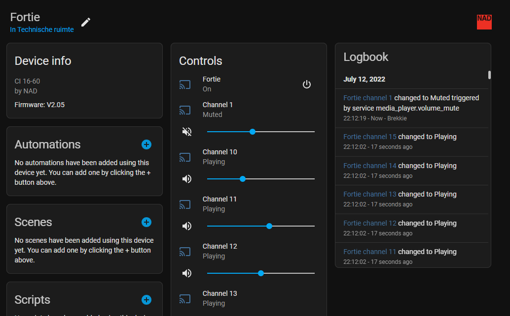
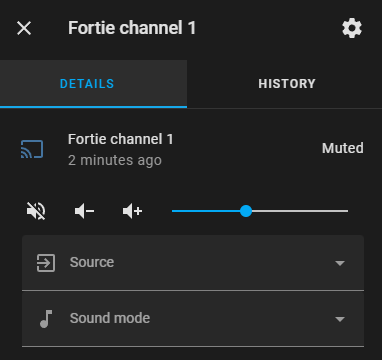
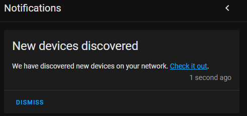
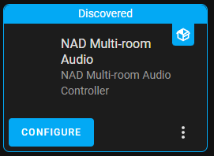
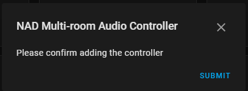
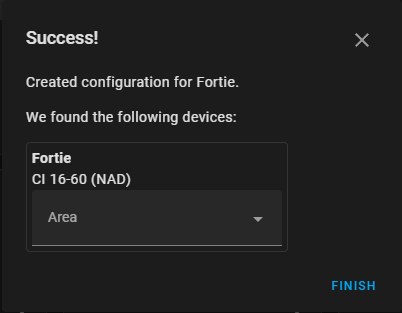
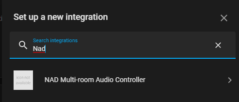
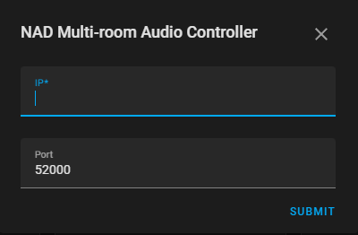

# NAD Multi-room Audio Controller Integration

This integration integrates with NAD multi-room audio amplifiers.
It provides control over power, output volume and muting, input selection, DSP presets, zones and the global inputs,
and reports temperatures, fans and channel protection.

## Overview

_The entities are named after the `Unit Name`, as configured in NAD's web interface.
In this case, that's 'Fortie'._

### Amplifier

The amplifier's media player controls the power. Its source selects one of the two global inputs, which override
the source of every output, or 'None'.

Besides that, the amplifier device has:

* A switch per global input and a number for its gain
* Configuration of the power-on method, standby time, power-on delay and green mode
* Input gains and stereo/mono summing per input pair (disabled by default)
* Temperature, fan and amplifier status sensors, and a protection sensor per channel
* Identify and restart buttons

### Channels

One media player is created for every output, named as in the web interface.
They support volume, mute, source (the input it plays) and sound mode (the DSP preset).
The volume range 0-100% maps onto the output gain of -6 dB to +6 dB, which is also available as a number in dB.

> **Note**
>
> The amplifier mutes outputs per stereo pair, so muting one channel also mutes its neighbour.

### Zones

Every zone that has channels assigned in the web interface gets a device of its own, so it can be put in an area,
with a media player that controls all of its channels together.
Changing a zone's volume moves all of its channels by the same amount, keeping their balance.

## Compatible devices

* NAD CI 16-60, tested on firmware V2.27. Firmware before V2.2x numbered channels differently and is not supported.

The integration reads the amplifier's state from its web interface and sends commands over its IP control protocol
(TCP port 52000). When the web interface can't be reached, for example because password protection is turned on,
it falls back to reading power, volume and mute over IP control.

Firmware updates are not offered; use NAD's web interface for those.

## Setup

> **Note**
> 
> This integration requires [HACS](https://hacs.xyz/docs/setup/download/) to be installed

1. Open HACS
2. _+ EXPLORE & DOWNLOAD REPOSITORIES_
3. Find _NAD Multi-room Audio Controller_ in this list
4. _DOWNLOAD THIS REPOSITORY WITH HACS_
5. _DOWNLOAD_
6. Restart Home Assistant (_Settings_ > _System_ >  _RESTART_)

The flow can now proceed in one of two ways:

### Automatic flow

 1. Through UPNP, the controller can be discovered automatically.

 2. Either click the _Check it out_ link or navigate to _Settings_ > _Devices & Services_ to find the discovery.

> **Note**
> 
> If this does not show up, please proceed with the _Manual installation_ flow

 3. After pressing _CONFIGURE_, a final confirmation is prompted.

 4. When _SUBMIT_ is pressed, success dialog should be shown.

 5. After optionally setting its area and confirming with _FINISH_, the integration is now active and ready to be used.

### Manual flow

 1. Navigate to the integrations page: _Settings_ > _Devices & Services_
 2. _+ ADD INTEGRATION_
 3. Select _NAD Multi-room Audio Controller_ in this selection window

 4. Enter the IP and Port (52000 by default) and press _SUBMIT_

 5. After optionally setting its area and confirming with _FINISH_, the integration is now active and ready to be used.

